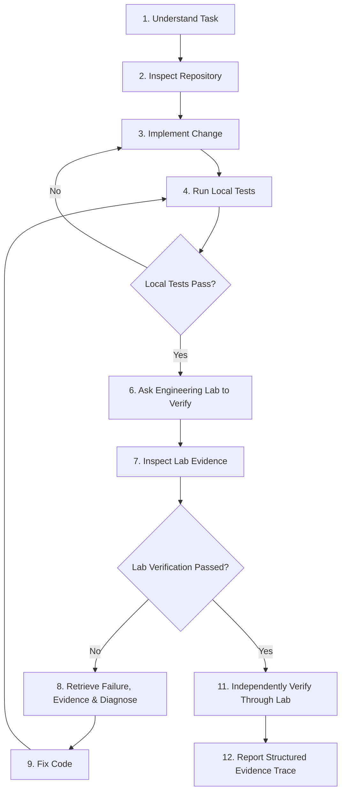

# Engineering Lab Skill

The **Engineering Lab** is an independent verification, quality assurance, and reliability system.
Antigravity is the development, reasoning, and build environment; the Engineering Lab is the authoritative verification system.

> **Core Principle**: An agent assertion that code works is insufficient. The standard of engineering completion requires:
> $$\text{Agent Implementation} + \text{Local Tests} + \text{Independent Lab Evidence} \implies \text{Verified Completion}$$

---

## When to Use the Engineering Lab

Do **NOT** use the Engineering Lab for every minor keystroke or syntax edit. Activate and use the Lab under the following specific conditions:

1. **After Implementing Significant Features**: When functional behavior or application contracts change.
2. **Before Considering a Feature Complete**: To satisfy the independent verification requirement of the Definition of Done.
3. **When a Regression is Suspected**: To query recent failure logs, inspect execution traces, and verify whether recent runs broke existing flows.
4. **When Application Reliability is Uncertain**: To consult prior reliability models, check predictive failure probability, and inspect posterior uncertainty bounds before making operational claims.
5. **When Debugging an Existing Failure**: To retrieve deep failure telemetry, examine verified evidence artifacts (DOM, screenshots, network logs), and obtain epistemic root cause diagnoses.

### When NOT to Use the Lab
* Trivial edits (documentation typos, comment updates, formatting).
* Before local unit tests pass (never ask the Lab to verify code that fails local compilation or unit tests).
* As an arbitrary command runner or shell execution service (the Lab enforces strict security boundaries).

---

## The 12-Step Engineering Lab Workflow



Detailed breakdown:
1. **Understand Task**: Identify user requirements and target application (`app_inventory`, `app_eda`, `app_booking`).
2. **Inspect Repository**: Locate relevant application and backend components.
3. **Implement Change**: Apply code modifications adhering to existing codebase patterns.
4. **Run Local Tests**: Execute local pytest, unit test suites, or linters via terminal.
5. **Inspect Local Results**: Ensure 100% of unit/integration tests pass locally.
6. **Ask Engineering Lab to Verify**: Invoke `start_test_session` or `inspect_application` via MCP.
7. **Inspect Evidence**: Retrieve test run results, pass/fail status, and telemetry digests.
8. **Handle Failures**:
   - Call `get_failure` to retrieve execution actions and stack traces.
   - Call `get_evidence` to retrieve DOM dumps, screenshots, or network logs.
   - Call `diagnose_failure` to receive epistemic root cause attributions.
9. **Fix**: Address diagnosed deficiencies in code.
10. **Re-run Local Tests**: Validate fix passes local unit regression.
11. **Independently Verify**: Trigger a new test run in the Engineering Lab.
12. **Report Evidence**: Provide an evidence-first summary with an Engineering Trace.

For a comprehensive walkthrough of each phase, see the [Workflow Guide](./references/workflow.md).

---

## Canonical MCP Tool Reference

The Engineering Lab exposes 10 canonical tools via Model Context Protocol (MCP). Use them according to their specific roles:

| Tool Name | Mode | Primary Purpose | Key Agent Rule |
| :--- | :---: | :--- | :--- |
| `inspect_application` | `READ_ONLY` | Inspect routes, capabilities, runtime posture | Do not mistake metadata for proof of runtime correctness. |
| `start_test_session` | `ACTION` | Initiate behavioral verification session | Preserve returned session ID; always supply `idempotency_key`. |
| `get_application_health` | `READ_ONLY` | High-level health state (`HEALTHY`, `DEGRADED`, etc.) | High-level health is context, not a replacement for testing. |
| `get_prediction` | `READ_ONLY` | Failure probability forecast ($P(\text{fail})$) | Risk signal only—never treat predictions as proof of failure or pass. |
| `get_uncertainty` | `READ_ONLY` | Posterior uncertainty interval & abstention flags | Always inspect uncertainty alongside predictions. |
| `list_failures` | `READ_ONLY` | Query recent failure history with severity filters | Respect cursor pagination; do not assume page 1 is exhaustive. |
| `get_failure` | `READ_ONLY` | Deep failure telemetry, stack traces, replay actions | Always retrieve failure details before attempting a diagnosis. |
| `diagnose_failure` | `READ_ONLY` | Multi-tier root cause analysis | Strictly distinguish `OBSERVED`, `INFERRED`, `HYPOTHESIZED`. |
| `get_evidence` | `READ_ONLY` | Cryptographically verified (SHA-256) artifacts | Prefer direct evidence over memory or assumptions. |
| `get_reliability_summary` | `READ_ONLY` | Longitudinal application risk & defect concentration | Useful for overall risk assessment and testing prioritization. |
| `get_repository_status` | `READ_ONLY` | Inspect active branch, HEAD commit, clean/dirty state | Track exact commit SHA for verification provenance. |
| `get_git_diff` | `READ_ONLY` | Retrieve structured file diffs and patches | Examine code changes prior to review and testing. |
| `get_commit` | `READ_ONLY` | Query commit metadata, author, parent SHA | Never rely on uncommitted local edits for release decisions. |
| `get_pull_request` | `READ_ONLY` | Query PR branches, status, and AI review findings | Ensure changes requested are addressed before CI/Lab gates. |
| `get_ci_status` | `READ_ONLY` | Inspect deterministic CI run outcomes and logs | CI verifies code-level units; CI pass does NOT imply Lab pass. |
| `get_release_readiness` | `READ_ONLY` | Evaluate Review, CI, Lab, and Evidence release gates | READY_FOR_RELEASE means gates passed; does NOT trigger deploy. |
| `get_github_repository` | `READ_ONLY` | Inspect remote GitHub repository metadata and branches | Inspect origin repository connection and default branch. |
| `get_github_pull_request` | `READ_ONLY` | Query real GitHub PR, exact head SHA, and synchronized state | Invalidate prior commit verification if head SHA changed. |
| `get_github_pull_request_diff` | `READ_ONLY` | Fetch raw PR diff and changed files from GitHub API | Review operations must operate on real PR diffs. |
| `get_github_ci_status` | `READ_ONLY` | Verify GitHub Actions workflow runs for exact head commit | CI conclusion must be success on exact commit SHA. |
| `get_github_checks` | `READ_ONLY` | List commit status check runs from GitHub | Inspect granular check statuses. |
| `get_github_pr_review` | `READ_ONLY` | Run static AI code review on GitHub PR diff | Classify findings into OBSERVED, INFERRED, HYPOTHESIS. |
| `list_prompts` | `READ_ONLY` | List all registered prompt definitions | Query active prompts in Prompt Reliability Lab. |
| `get_prompt` | `READ_ONLY` | Get prompt definition and version history | Inspect immutable versions of a prompt. |
| `get_prompt_version` | `READ_ONLY` | Get exact template and schemas of prompt version | Evaluated versions are immutable. |
| `create_prompt_version` | `ACTION` | Create a new draft/candidate prompt version | Propose new version without mutating existing ones. |
| `list_evaluation_suites` | `READ_ONLY` | List versioned evaluation suites | Browse benchmark suites. |
| `get_evaluation_suite` | `READ_ONLY` | Get evaluation suite and test cases | Inspect test cases across evaluation categories. |
| `start_evaluation` | `ACTION` | Execute evaluation suite against prompt version | Produces reproducible execution records & snapshot. |
| `get_evaluation` | `READ_ONLY` | Get evaluation run results and diagnoses | Review pass rates and per-case results. |
| `get_evaluation_result` | `READ_ONLY` | Get single test case evaluation and diagnosis | Review deterministic, grounding, and semantic scores. |
| `compare_prompt_versions` | `READ_ONLY` | Compare two prompt versions on frozen suite | Evaluates multi-dimensional diffs without single score. |
| `get_prompt_regressions` | `READ_ONLY` | Detect case regressions between prompt versions | Surfacing critical regressions is mandatory. |
| `get_prompt_diagnosis` | `READ_ONLY` | Get multi-layer causal diagnosis for AI failure | Distinguishes PROMPT, MODEL, RETRIEVAL, TOOL, etc. |
| `get_prompt_evidence` | `READ_ONLY` | Retrieve execution record and grounding evidence | Verify claim-level evidence and execution hashes. |

> **Security Restriction**: Only canonical read-oriented tools and bounded actions are exposed. No arbitrary shell, SQL, filesystem, credential, merge, prompt auto-deployment, or production mutations.

For schemas, arguments, and return envelopes, see the [Tool Usage Reference](./references/tool-usage.md).

---

## Prompt Reliability Lab Operational Principles (Slice 7.7)

When evaluating AI prompts and model interactions:
1. **Prompts are Engineering Artifacts**: Prompt versions are strictly immutable once evaluated. Never attempt to edit an evaluated version in-place.
2. **Multi-Causal Layer Attribution**: A failed output must NOT be assumed to be a prompt failure. Distinguish `PROMPT_DEFECT`, `MODEL_BEHAVIOR`, `RETRIEVAL_FAILURE`, `CONTEXT_FAILURE`, `TOOL_FAILURE`, `APPLICATION_LOGIC`, `PARSER_FAILURE`, `SCHEMA_FAILURE`, `DATA_FAILURE`, `EVALUATOR_FAILURE`, and `UNKNOWN`.
3. **Deterministic Evaluation Precedence**: Schema validation, rule constraints, and syntax checks run before LLM judges. A single LLM judge cannot override deterministic failures.
4. **Epistemic Certainty**: Preserve `UNKNOWN` and `ABSTAINED` states; never coerce them into `PASS`.
5. **Regression Detection**: New prompt versions must be evaluated against the identical frozen evaluation suite. Critical regressions must never be hidden behind aggregate improvements.
6. **No Autonomous Deployment**: Candidate prompt improvements require human review and approval. Automated prompt deployment to production is strictly forbidden.

---

## Mandatory Epistemic Abstention Rule

If the Engineering Lab returns:
* `status: "ABSTAINED"`
* `RELIABILITY_ABSTAINED`
* `UNKNOWN`

**You MUST NOT invent a conclusion or default to assuming the application is healthy.**

- **CORRECT**: *"The Engineering Lab does not have sufficient evidence or confidence to determine reliability for this application in the current operating regime (Uncertainty width: 0.42, Covariate shift: True). Verification remains inconclusive."*
- **INCORRECT**: *"The model did not find any failures, so the system is healthy."*

---

## 9-Stage Definition of "Done"

Do not conflate implementation completion with verification completion. Every engineering task follows this strict 9-stage lifecycle progression:

```text
[ IMPLEMENTED ]
       │
       ▼
[ LOCAL_TESTED ]
       │
       ▼
 [ COMMITTED ]
       │
       ▼
 [ PR_CREATED ]
       │
       ▼
  [ REVIEWED ]
       │
       ▼
[ CI_VERIFIED ]
       │
       ▼
[ LAB_VERIFIED ]
       │
       ▼
[ EVIDENCE_RECORDED ]
       │
       ▼
[ READY_FOR_HUMAN_RELEASE / COMPLETE ]
```

1. **IMPLEMENTED**: Code changes are authored in Antigravity.
2. **LOCAL_TESTED**: Local developer unit tests pass on the development machine.
3. **COMMITTED**: Code changes committed to a Git branch with clean parent provenance.
4. **PR_CREATED**: Real GitHub Pull Request opened or synchronized.
5. **REVIEWED**: Static AI Code Review has evaluated the actual PR diff with no blocking critical/high findings.
6. **CI_VERIFIED**: GitHub Actions CI workflow runs execute and conclude with `success` on the exact head commit SHA.
7. **LAB_VERIFIED**: Independent Engineering Lab behavioral test session executes against the running application.
8. **EVIDENCE_RECORDED**: Forensic artifacts, run logs, and SHA-256 digests are retrieved and linked.
9. **READY_FOR_HUMAN_RELEASE (COMPLETE)**: Release readiness evaluator confirms all gates passed. Human approval is required before merge or deployment.

### Explicit Agent Directives
- **Inspect exact PR / Head SHA**: Always verify that CI runs and Lab tests match the exact head commit SHA of the PR.
- **Never assume CI passed**: An agent claim is non-binding; query `get_github_ci_status` directly.
- **Never assume runtime verification passed**: Code-level CI pass does NOT imply behavioral correctness.
- **Run Lab verification after CI passes**: Only execute behavioral test runs once deterministic CI build gates succeed.
- **Preserve evidence**: Record cryptographic artifact digests and test session IDs.
- **Distinguish observations from interpretations**: Clearly label syntax evidence as `OBSERVED`, concurrency risks as `INFERRED`, and speculative side effects as `HYPOTHESIS`.
- **Stop when required evidence is unavailable**: Return `INSUFFICIENT_DATA` or `NOT_READY` rather than guessing.
- **Never merge automatically**: The merge decision belongs strictly to the human engineering authority.

---

## Evidence-First Engineering Trace

When communicating verification results or recording audit trails, use the complete lifecycle trace:

```text
Task: <Engineering objective>
Repository: <Repository name>
Branch: <Active Git branch>
Commit: <Target commit SHA>
PR: <GitHub PR number and URL>
Changes: <Changed files and summary of modifications>
Local Tests: <Local test execution command and result>
Review: <AI Code Review status and finding counts>
CI: <GitHub Actions CI run ID, workflow, and outcome>
Lab Verification: <Independent Engineering Lab session ID and pass/fail counts>
Evidence: <Specific run ID, HTTP status code, or SHA-256 artifact digest>
Release Readiness: <NOT_READY | BLOCKED | READY_FOR_RELEASE>
```

> **Note on Agent Transparency**: Never expose internal model chain-of-thought or raw reasoning blocks. Record observable engineering facts, actions, results, and evidence.

For detailed templates and examples, see the [Engineering Trace Template](./references/engineering-trace.md) and [Evidence Policy](./references/evidence-policy.md).

---

## Security Boundary & Human Oversight

1. **Zero System Escapes**: The Engineering Lab MCP server strictly forbids arbitrary shell execution, raw SQL queries, direct filesystem traversal, or credentials inspection. Never attempt to use MCP tools to bypass security boundaries.
2. **Missing Capabilities**: If an operation cannot be performed via the 10 canonical tools, report `TOOL_UNAVAILABLE`.
3. **Action Authorization**: The `start_test_session` tool is an `ACTION` requiring valid idempotency keys. Any future actions affecting production systems or deployments require explicit human confirmation.

---

## Helper Scripts

Convenient Python scripts are provided in [`scripts/`](./scripts/) for interacting with the Lab from Antigravity:
* [`check_lab_health.py`](./scripts/check_lab_health.py): Validates connection to the MCP server and checks registered tools.
* [`verify_application.py`](./scripts/verify_application.py): Executes an automated verification pass for an application and outputs an Engineering Trace.
