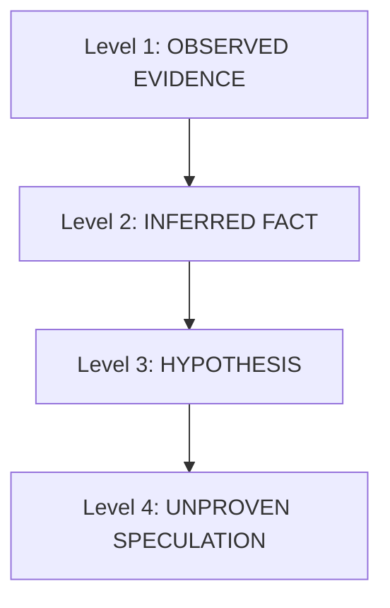

# Evidence Policy & Epistemic Standards

This policy governs what constitutes valid engineering evidence, how evidence must be verified, and the epistemic standards Antigravity agents must uphold when interacting with the Engineering Lab.

---

## 1. Hierarchy of Engineering Claims

Every statement made regarding application state, failure causes, or verification success must be assigned to one of four evidentiary levels:

### Level 1: OBSERVED EVIDENCE (Empirically Measured)
* Direct, immutable, recorded telemetry.
* Examples:
  - HTTP 500 status code returned by `POST /api/v1/inventory`.
  - DOM snapshot containing `
Item not found
`.
  - Stack trace identifying `IndexError: list index out of range at line 142`.
  - Playwright test runner exit code `1`.
* **Standard**: Citable by `run_id`, `failure_id`, or `evidence_id` with associated SHA-256 cryptographic digest.

### Level 2: INFERRED FACT (Logically Deduced from Observations)
* Deductions that follow directly from observed facts under known system semantics.
* Examples:
  - If a 500 error occurs with a `ZeroDivisionError` stack trace in `compute_tax()`, it is inferred that the tax calculation handler crashed due to unhandled zero inputs.
* **Standard**: Must link explicitly to the underlying Level 1 observations.

### Level 3: HYPOTHESIS (Plausible Explanation Requiring Code Verification)
* Plausible potential root causes or system behaviors that have not yet been directly proven.
* Examples:
  - "The database connection pool may have been exhausted under concurrent load."
  - "The front-end state may be desynchronized after rapid button clicks."
* **Standard**: Must be explicitly labeled as `[HYPOTHESIS]` and verified via code inspection or targeted testing before being acted upon.

### Level 4: UNPROVEN SPECULATION (Strictly Prohibited)
* Assumptions made without supporting telemetry or code confirmation.
* Examples:
  - "The application probably works now because the syntax error was resolved."
  - "The test was probably flaky."
* **Standard**: Prohibited in all Engineering Lab interactions and reports.

---

## 2. Epistemic Invariants

1. **Hypothesis Non-Promotion**: An agent must NEVER promote a Level 3 hypothesis to a Level 1 observed fact without direct, new evidentiary proof.
2. **Abstention Respect**: When the Engineering Lab reports `RELIABILITY_ABSTAINED` or `UNKNOWN`, the agent must treat the state as inconclusive. Fabricating confidence or defaulting to a "safe" conclusion violates epistemic integrity.
3. **Evidence Over Memory**: When asked about past runs or failure history, the agent must query `list_failures` or `get_evidence` rather than relying on session memory.

---

## 3. Redaction & Credential Protection

The Engineering Lab operates under a **Zero-Leakage Guarantee**:
* **Protected Elements**: Bearer tokens, JSON Web Tokens (JWT), AWS Access Keys (`AKIA...`), OpenAI API keys (`sk-...`), private PEM keys, database passwords, session cookies, and authorization headers.
* **Redaction Format**: Sensitive values are replaced with standardized markers (e.g., `Bearer [REDACTED]`, `[REDACTED_JWT]`, `AKIA[REDACTED]`).
* **Agent Rule**: The agent must never attempt to de-anonymize, reconstruct, or prompt for redacted credentials. If a test failure relates to authentication, diagnose the authentication mechanism without requesting the raw secret.

---

## 4. Cryptographic Provenance Verification

When retrieving artifacts via `get_evidence`:
1. Each artifact contains a `sha256` digest calculated over its raw bytes.
2. The agent should verify that the returned artifact content matches the expected digest when performing critical compliance or audit traces.
3. Provenance metadata (`model_version`, `feature_schema_version`, `snapshot_id`) must be preserved in all forwarded reports.

---

## 5. Anti-Patterns to Avoid

| Anti-Pattern | Description | Corrective Behavior |
| :--- | :--- | :--- |
| **"Unit tests pass, so we're done"** | Conflating local unit test execution with full verification. | Run `start_test_session` in the Lab to verify end-to-end behavior. |
| **"It's just a warning"** | Ignoring uncertainty warnings or covariate shift flags. | Record the warning in the Engineering Trace and inspect edge cases. |
| **"Fixed the bug" (no re-test)** | Declaring a bug fixed without running a post-fix test. | Execute a new test run in the Lab and compare before/after evidence. |
| **Silent conversion** | Converting `UNKNOWN` to `HEALTHY` or `ABSTAINED` to `FAILURE`. | Explicitly state that verification is inconclusive due to data scarcity. |
