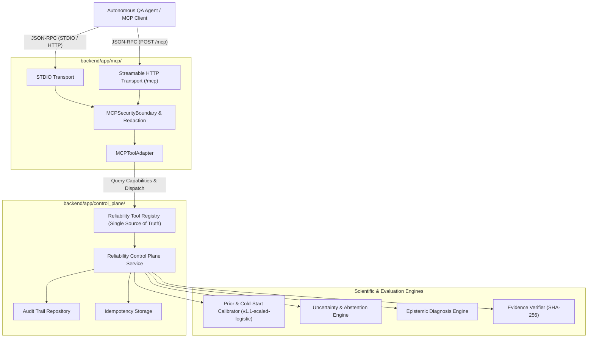

# Architecture Specification: Model Context Protocol (MCP) Integration

**Slice**: 7.3  
**Status**: APPROVED & IMPLEMENTED  
**Protocol Version**: `2024-11-05`  
**MCP SDK Version**: `2.2.0`  
**MCP Server Version**: `7.3.0`  
**Tool Contract Version**: `reliability-tools/v1`  

---

## 1. Why MCP Exists

Modern autonomous QA agents and LLM-based reasoning runtimes require structured, discoverable, schema-validated protocols to observe systems, invoke actions, and query analytical services. Without a standard protocol, agents are coupled to bespoke REST endpoints or brittle ad-hoc wrappers.

The **Model Context Protocol (MCP)** provides an open, standardized RPC architecture over JSON-RPC 2.0 enabling autonomous agents (Claude Desktop, IDE agents, autonomous testing harnesses, CLI agents) to dynamically discover capabilities, inspect typed schemas, and invoke tools with bidirectional context exchange.

In the AI Application Reliability Platform:
> **MCP is the interface. The Control Plane is the authority. The Reliability Engines are the intelligence. The Scientific Snapshots are immutable evidence.**
> 
> * MCP does NOT contain reliability intelligence.
> * MCP does NOT contain scientific methodology.
> * MCP does NOT bypass the control plane.
> * MCP is strictly a transport and protocol adapter.

---

## 2. System Architecture

The MCP integration forms a strict unidirectional adapter layer sitting atop the Slice 7.2 Reliability Control Plane:



---

## 3. Dependency Direction & Architectural Boundaries

Strict architectural layering is enforced by automated test suites (`test_mcp_architecture.py`):
1. **Domain and Control Plane Layer**: `backend/app/control_plane/`, `backend/app/models/`, `backend/app/services/`, and `backend/app/repositories/` have **ZERO imports** from `mcp`.
2. **Adapter Layer**: `backend/app/mcp/` imports from `backend/app/control_plane/` to access the `ToolRegistry`, `ReliabilityControlPlaneService`, models, and exceptions.
3. **No Direct Execution**: The MCP layer never talks to databases, raw operating system processes, or file systems directly. It delegates 100% of execution to the `ReliabilityControlPlaneService`.

---

## 4. Single Source of Truth: Canonical Tool Registry

The MCP server never defines tools statically or independently. The canonical `ToolRegistry` established in Slice 7.2 remains the sole authority.

During startup, `MCPToolAdapter` queries the registry:
```python
tools = self.registry.list_tools()
for tool_def in tools:
    mcp_tool = canonical_tool_to_mcp_tool(tool_def)
    # Dynamically exposed via MCP ListTools handler
```

If a tool is modified, added, or removed in the control plane registry, the MCP schema and capability exposure update automatically without contract drift.

The 10 Canonical Tools:
1. `inspect_application` (READ_ONLY)
2. `start_test_session` (ACTION)
3. `get_application_health` (READ_ONLY)
4. `get_prediction` (READ_ONLY)
5. `get_uncertainty` (READ_ONLY)
6. `list_failures` (READ_ONLY)
7. `get_failure` (READ_ONLY)
8. `diagnose_failure` (READ_ONLY)
9. `get_evidence` (READ_ONLY)
10. `get_reliability_summary` (READ_ONLY)

---

## 5. Input & Output Contract Equivalence

### Input Schemas
The MCP input schema (`inputSchema`) is derived directly from the Pydantic request models in the canonical tool definitions via `request_model.model_json_schema()`.
* Required vs. optional fields are preserved.
* Default values, types, and nested constraints are strictly exposed.
* No handwritten JSON Schema drift can occur.

### Output Envelopes
Responses preserve the Slice 7.2 canonical `ToolEnvelope`:
```json
{
  "tool_name": "get_prediction",
  "tool_version": "1.0.0",
  "request_id": "req-98848a29-c8c3",
  "timestamp": "2026-09-25T18:47:33.456Z",
  "application_id": "app_inventory",
  "session_id": null,
  "status": "SUCCESS",
  "data": {
    "probability": 0.32,
    "confidence_interval": [0.18, 0.46],
    "model_version": "v1.1-scaled-logistic",
    "feature_schema_version": "v1.0-temporal"
  },
  "provenance": { ... },
  "error": null
}
```
In MCP v2.2.0, the response is delivered as structured content (`structured_content=envelope`) alongside formatted JSON text (`text=json.dumps(envelope)`), validated against the envelope schema.

---

## 6. Supported Transports

### 6.1 STDIO Transport
* **Use Cases**: Local CLI agent runs, desktop assistants (Claude Desktop), local developer workflows, MCP Inspector.
* **Safety Rule**: `stdout` is exclusively dedicated to JSON-RPC protocol framing. Normal application and diagnostic logging is redirected to `stderr` or rotating log files.
* **Command**:
  ```bash
  python scripts/run_mcp_server.py --transport stdio
  ```

### 6.2 Streamable HTTP Transport
* **Use Cases**: Remote agent workers, web clients, distributed QA runners.
* **Endpoint**: `/mcp`
* **Protocol**: Streamable HTTP with stateless or stateful sessions as supported by the MCP SDK v2.2.0. Mounted directly on the FastAPI application (`main.py`) or run standalone via:
  ```bash
  python scripts/run_mcp_server.py --transport http --port 8005
  ```

### 6.3 Cross-Transport Equivalence
Automated tests (`test_mcp_http.py::test_cross_transport_equivalence_stdio_and_http`) prove that the domain payload returned for any tool invocation over STDIO is identical to that returned over Streamable HTTP.

---

## 7. Security Model & Boundary Controls

### 7.1 Absolute System Access Boundary
The MCP adapter implements an active `MCPSecurityBoundary` that intercepts tool definitions and invocations:
* **Prohibited Subsystems**: `shell`, `exec`, `sql`, `db`, `fs`, `filesystem`, `eval`, `python`, `playwright_raw`, `browser_exec`.
* Any attempt by a caller to request system-level execution results in an immediate `UNAUTHORIZED_ACTION` response.
* No raw browser action controls (`click`, `type`, `goto`) are exposed in this slice.

### 7.2 Zero-Leakage Redaction
All outputs from the control plane pass through regex-based credential and secret sanitizers before serialization to MCP transport:
* Bearer tokens (`Bearer [REDACTED]`)
* JWTs (`[REDACTED_JWT]`)
* AWS keys (`AKIA[REDACTED]`)
* API keys (`sk-[REDACTED]`)
* Passwords, cookies, and database connection strings

### 7.3 Auditing
Every tool execution generates a cryptographically hashed `ToolAuditEvent` recorded in the audit store:
* Request & response SHA-256 hashes
* Client identity, request ID, tool name, tool version
* Transport origin (`stdio` vs `streamable_http`)
* Execution latency in milliseconds

---

## 8. Provenance & Epistemic Distinctions

1. **Prediction Provenance**: Responses retain `model_version: "v1.1-scaled-logistic"` and `feature_schema_version: "v1.0-temporal"`. The MCP adapter never synthesizes or alters provenance.
2. **Evidence Integrity**: Evidence retrieved through `get_evidence` includes SHA-256 hashes for data integrity verification.
3. **Epistemic Classifications**: Diagnostic outputs retain epistemic labels (`OBSERVED`, `INFERRED`, `HYPOTHESIZED`). The adapter never converts `HYPOTHESIZED` root causes into `OBSERVED` facts.

---

## 9. Error Mapping & Abstention Semantics

### Deterministic Error Codes
The MCP adapter translates internal domain exceptions into structured `ToolErrorPayload` structures:
* `APPLICATION_NOT_FOUND`
* `SESSION_NOT_FOUND`
* `FAILURE_NOT_FOUND`
* `PREDICTION_NOT_FOUND`
* `EVIDENCE_NOT_FOUND`
* `INSUFFICIENT_EVIDENCE`
* `RELIABILITY_ABSTAINED`
* `UNAUTHORIZED_ACTION`
* `INVALID_REQUEST`
* `INTERNAL_ERROR`

### Abstention is NOT an Error
When predictive uncertainty exceeds acceptable bounds or covariates shift outside the training domain:
* The control plane returns `status: "ABSTAINED"` with `RELIABILITY_ABSTAINED`.
* The MCP adapter sets `is_error=False`.
* The result is communicated as a valid semantic state. The autonomous agent is expected to recognize abstention as an indication to acquire more evidence rather than treating it as a system failure.

---

## 10. Permission Model & Idempotency

### Permission Enforcing
* `ACTION` tools (`start_test_session`) require action permissions.
* Read-only tools (`inspect_application`, `get_prediction`, etc.) are open to inspection clients.
* Attempting an unauthorized action triggers an `UNAUTHORIZED_ACTION` tool error envelope.

### Idempotency Deduplication
Repeated invocations of `start_test_session` bearing the same `idempotency_key` return the existing session record. Duplicate sessions are not created.

---

## 11. MCP Client Usage Example

```python
import asyncio
from mcp.client.session import ClientSession
from mcp.client.stdio import stdio_client, StdioServerParameters

async def run_qa_agent():
    params = StdioServerParameters(
        command="python",
        args=["scripts/run_mcp_server.py", "--transport", "stdio"],
    )
    async with stdio_client(params) as (read_stream, write_stream):
        async with ClientSession(read_stream, write_stream) as session:
            await session.initialize()
            
            # 1. Discover tools
            tools = await session.list_tools()
            print(f"Discovered {len(tools.tools)} canonical tools")
            
            # 2. Inspect target application
            health = await session.call_tool(
                "get_application_health",
                arguments={"application_id": "app_inventory"}
            )
            print("Health envelope:", health.structured_content)

asyncio.run(run_qa_agent())
```

---

## 12. MCP Inspector Workflow

To inspect the tools and schemas interactively with the official MCP Inspector:

```bash
# 1. Start the MCP Inspector against the local STDIO server
npx @modelcontextprotocol/inspector python scripts/run_mcp_server.py --transport stdio

# 2. In the opened web UI:
# - Connect to the running session
# - View all 10 canonical tools and their parameter schemas
# - Execute inspect_application with {"application_id": "app_inventory"}
# - Inspect the structured ToolEnvelope and provenance
```

---

## 13. Future Autonomous Agent Integration

In upcoming slices (Slice 8.x):
1. **Autonomous Test Planner**: An autonomous LLM agent equipped with the MCP client will inspect application health, identify under-tested or high-uncertainty areas, and invoke `start_test_session`.
2. **Active Learning Loop**: High uncertainty outputs will trigger targeted test generation to collect specific evidence, shrinking uncertainty bounds iteratively.
3. **Execution Isolation**: Browser automation actions (Playwright) will execute in sandboxed runners orchestrated behind the control plane, keeping raw execution isolated from external agent prompts.
